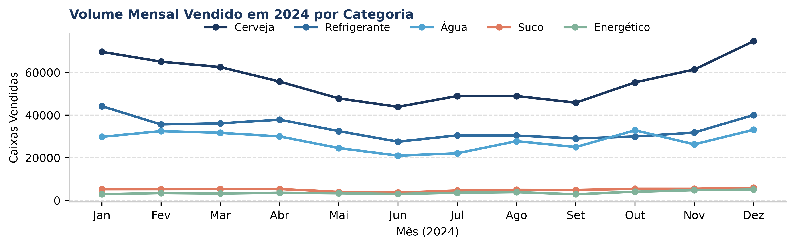
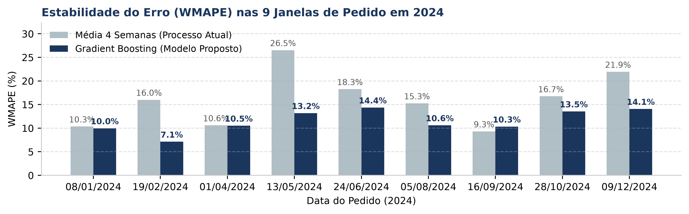
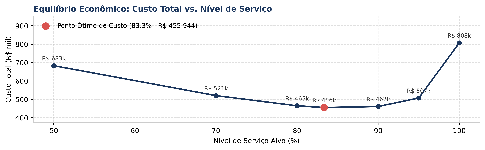

# Drinks Supply Planning (Cantil Bebidas)

Previsão de demanda em horizonte de 21 dias e política de reposição orientada a custo, para uma distribuidora de bebidas com 20 SKUs.

Projeto desenvolvido na pós-graduação em Análise de Dados e Inteligência Artificial.

**Stack:** Python · Pandas · NumPy · Scikit-learn · Matplotlib · ReportLab · Jupyter Notebook

📄 **Relatório completo:** [relatorio/resumo_executivo.pdf](relatorio/resumo_executivo.pdf)

---

## O problema

A Cantil faz pedidos à indústria **toda segunda-feira** (ciclo de 7 dias) e a entrega leva **14 dias**. Cada pedido precisa cobrir a demanda dos próximos **21 dias** (14 de entrega + 7 de ciclo).

Hoje o comprador usa a média das últimas 4 semanas com uma folga fixa de 24 dias. O resultado é um estoque médio de **27,8 dias** de cobertura no CD e muito capital parado.

**Perguntas que o projeto responde:**

1. Qual horizonte de previsão usar, quais produtos ficam fora do modelo e quais informações podem entrar?
2. O que a base mostra sobre volume, sazonalidade e promoções?
3. Qual modelo prever melhor a demanda de 21 dias, sem vazamento de dados?
4. O desempenho se mantém ao longo do ano?
5. Qual a folga ideal de estoque e quanto isso economiza em R$?

---

## Resultados

| Indicador | Processo atual (média de 4 semanas) | Gradient Boosting |
|---|---|---|
| WMAPE no teste (170 previsões) | 16,7% | **12,5%** |
| Viés no teste | -9,9% | **-2,8%** |
| WMAPE em 9 janelas de 2024 | 16,0% | **11,5%** |
| Janelas em que vence a média de 4 semanas | – | **8 de 9** |
| Custo total simulado em 2024 | R$ 2.235.863 | **R$ 455.944** |

- **Economia simulada de R$ 1.779.919 (79,6%)** em 2024, com ruptura em apenas 17,0% das janelas.
- **Nível de serviço ótimo de 83,3%**, que resulta em folga de 16,7% sobre a previsão. Atingir 100% custaria R$ 808 mil, quase o dobro do ponto ótimo.
- Promoções elevam a venda média diária em **50,5%**. O pico semanal é na sexta e o vale no domingo.

### Gráficos







---

## Metodologia

O trabalho segue o CRISP-DM. As decisões que mais pesaram:

- **Escopo:** 17 dos 20 SKUs entram no modelo. ENE-02 (lançamento com menos de 6 meses) fica sob gestão manual. REF-04 e SUC-03 (sem vendas há mais de 90 dias) ficam bloqueados.
- **Teste de antecedência:** só entram variáveis conhecidas no ato do pedido (vendas passadas, calendário, feriados e promoções negociadas). Ficam de fora `preco_caixa` e `estoque_cd`.
- **Validação sem vazamento:** o treino termina 21 dias antes do primeiro pedido de teste, e a avaliação usa apenas segundas-feiras.
- **Política de estoque:** a folga vem do problema do jornaleiro (*newsvendor*) "equilíbrio entre o custo de faltar", calibrada pelo quantil dos erros fora da amostra.

---

## Trechos principais do código

O código completo não está publicado. Estes trechos mostram o núcleo da solução.

### 1. Parâmetros do negócio e horizonte

```python
PRAZO_ENTREGA_DIAS = 14   # prazo de entrega da indústria
CICLO_PEDIDO_DIAS = 7     # pedido semanal (toda segunda-feira)
CUSTO_FALTA = 0.25        # falta de 1 caixa custa 25% do preço
CUSTO_SOBRA = 0.05        # sobra de 1 caixa custa 5% do preço

# O pedido precisa cobrir da chegada do pedido atual até a chegada do próximo
HORIZONTE_DIAS = PRAZO_ENTREGA_DIAS + CICLO_PEDIDO_DIAS  # 21 dias
```

### 2. Atributos e alvo

```python
def soma_passada(tabela, coluna, dias):
    """Soma dos últimos 'dias' dias até hoje (inclusive), por SKU."""
    return tabela.groupby("sku")[coluna].transform(lambda s: s.rolling(dias).sum())

def soma_futura(tabela, coluna, dias):
    """Soma dos próximos 'dias' dias (de t+1 até t+dias), por SKU."""
    return tabela.groupby("sku")[coluna].transform(lambda s: s.shift(-dias).rolling(dias).sum())

# Vendas recentes: somas de 7, 14, 21 e 28 dias
for dias in [7, 14, 21, 28]:
    tabela[f"soma_{dias}d"] = soma_passada(tabela, "caixas_vendidas", dias)

# Futuro conhecido na hora do pedido: feriados e promoções negociadas
tabela["feriados_prox21d"] = soma_futura(tabela, "feriado", HORIZONTE_DIAS)

# Alvo: o que de fato foi vendido de t+1 a t+21
tabela["alvo_21d"] = soma_futura(tabela, "caixas_vendidas", HORIZONTE_DIAS)

# Trava contra vazamento: o alvo e o baseline nunca entram em X
assert ALVO not in FEATURES and "baseline_4sem_21d" not in FEATURES
```

### 3. Métricas: WMAPE e viés

```python
def wmape(real, previsto):
    """Erro percentual absoluto ponderado pelo volume real."""
    return mean_absolute_error(real, previsto) / np.mean(real)

def vies(real, previsto):
    """Positivo = superestima (sobra). Negativo = subestima (falta)."""
    return (np.sum(previsto) - np.sum(real)) / np.sum(real)
```

### 4. Pipelines e comparação dos três modelos

```python
def montar_pipeline(modelo, escalar):
    preparo = ColumnTransformer([
        ("categorias", OneHotEncoder(handle_unknown="ignore", sparse_output=False), FEATURES_CAT),
        ("numericas", StandardScaler() if escalar else "passthrough", FEATURES_NUM),
    ])
    return Pipeline([("preparo", preparo), ("modelo", modelo)])

modelos = {
    "Ridge": montar_pipeline(Ridge(alpha=1.0), escalar=True),
    "Random Forest": montar_pipeline(
        RandomForestRegressor(n_estimators=200, min_samples_leaf=5, random_state=42),
        escalar=False),
    "Gradient Boosting": montar_pipeline(HistGradientBoostingRegressor(random_state=42), escalar=False),
}

# Treino sempre no passado; previsão com piso em zero (demanda não é negativa)
for nome, pipeline_modelo in modelos.items():
    pipeline_modelo.fit(treino[FEATURES], treino[ALVO])
    previsto = np.clip(pipeline_modelo.predict(teste[FEATURES]), 0, None)
```

### 5. Nível de serviço ótimo e folga de estoque

```python
# Razão crítica: quanto mais cara a falta, maior o nível de serviço ótimo
NIVEL_SERVICO = CUSTO_FALTA / (CUSTO_FALTA + CUSTO_SOBRA)   # 0,25 / 0,30 = 83,3%

# Folga = quantil dos erros relativos fora da amostra
# ('anual' guarda real vs. previsto das janelas de 2024)
anual["erro_relativo"] = anual["real"] / anual["previsto"] - 1
FOLGA_PCT = anual["erro_relativo"].quantile(NIVEL_SERVICO)   # +16,7%

# Quanto pedir = previsão + folga
anual["cobre_proposta"] = anual["previsto"] * (1 + FOLGA_PCT)
```

---

## Limitações

- A folga de 16,7% foi calibrada nos erros de 2024. Em produção, ela deve ser atualizada apenas com erros passados.
- A simulação de custos usa os parâmetros do enunciado (falta de 25% e sobra de 5% do preço).
- Os dados são de um case acadêmico e não estão publicados neste repositório.


---

**Autor:** Arnald Weger · [arnaldweger.helferweg.shop](https://arnaldweger.helferweg.shop/)
